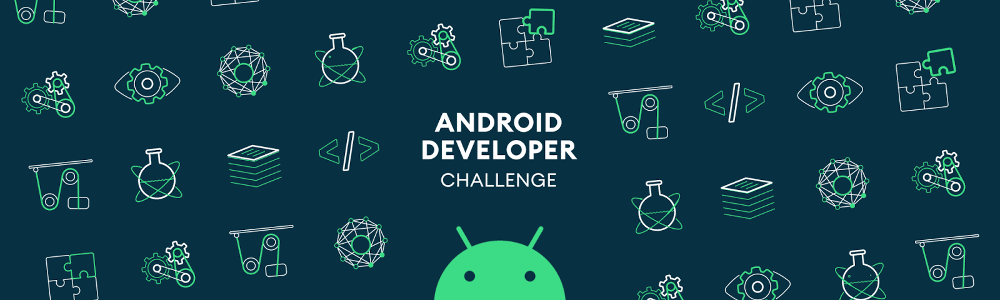

<h1 align="center">Hi 👋, I'm Hafiza Shadaf Rimi</h1>
<h3 align="center">An aspiring Mobile App Developer specializing in Android & Flutter Development.</h3>

- 🔭 I’m currently working on **Calorie Tracking App**

- 🌱 I’m currently learning **Currently exploring Flutter and Modern Mobile App Development.**

- 💬 Ask me about **Flutter | Dart | Firebase | Android**

- 📫 How to reach me **hafizashadafrimi@gmail.com**

- ⚡ Fun fact **A perfectionist who loves getting every detail right. ✨**

<h3 align="left">Connect with me:</h3>

<h3 align="left">Languages and Tools:</h3>

                      

